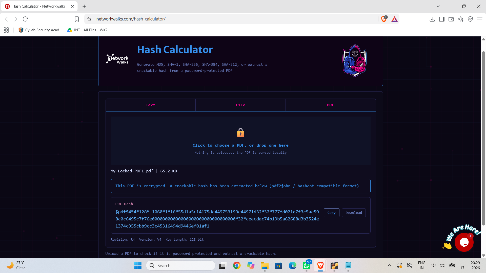

# NetworkWalks – Week 03: Password Security

**Program:** NetworkWalks Cybersecurity Program  
**Batch:** B084B  
**Author:** Prathamesh Kisan Satre

---

## About This Repository

This repository contains my Week 03 practical work as part of the NetworkWalks Cybersecurity Program.

This week's practical work focused on password security, password-protected PDF files, hash extraction, hash calculation, and hands-on exercises using John the Ripper (JTR) and NetworkWalks lab tools.

## Tools Used

- John the Ripper (JTR)
- NetworkWalks Lab Tools
- Hash Utilities
- Windows Environment

---

## Practical Work and Screenshots

### 1. Settings JTR

Screenshot documenting the John the Ripper settings used during the practical.


### 2. Hash Extract

Screenshot of the hash extraction practical exercise.


### 3. hash File

Screenshot showing the hash file used during the practical.


### 4. Jtr Password Crack

Screenshot documenting the John the Ripper password auditing exercise.


### 5. Flag 1

Screenshot from the first flag-related lab exercise.


### 6. Flag 3

Screenshot from the third flag-related lab exercise.


### 7. Hash Calculation

Practical exercise related to hash calculation.



### 8. Hash

Screenshot of the hash-related practical exercise.


### 9. Password Crack

Screenshot documenting the password auditing practical.


### 10. Locked PDF

Practical exercise involving a password-protected PDF file.


### 11. Flag

Screenshot from the flag-related practical exercise.


---

## Learning Outcomes

Through these practical exercises, I gained practical exposure to:

- Understanding password security concepts.
- Working with password-protected PDF files.
- Understanding John the Ripper and its settings.
- Learning about hash extraction.
- Understanding hash files and hash calculation.
- Exploring password auditing concepts.
- Working with cybersecurity lab tools.
- Practicing in an authorized lab environment.

---

## Repository Structure

```text
NetworkWalks-Week-03-Password-Security/
│
├── README.md
│
└── Screenshots/
    ├── Settings JTR.png
    ├── Hash Extract.png
    ├── hash File.png
    ├── Jtr Password Crack.png
    ├── Flag 1.png
    ├── Flag 3.png
    ├── Hash_Calculation.png
    ├── Hash.png
    ├── Password_Crack.png
    ├── Locked_pdf.png
    └── Flag.png
```

---

## Disclaimer

All practical activities documented in this repository are intended for educational purposes and authorized cybersecurity lab environments. Testing should only be performed on files and systems that I own or have permission to assess.

---

## Acknowledgement

Thanks to **NetworkWalks** and **Waqas Karim** for the guidance and learning opportunities.

---

**Author:** Prathamesh Kisan Satre  
**Program:** NetworkWalks Cybersecurity Program  
**Batch:** B084B
