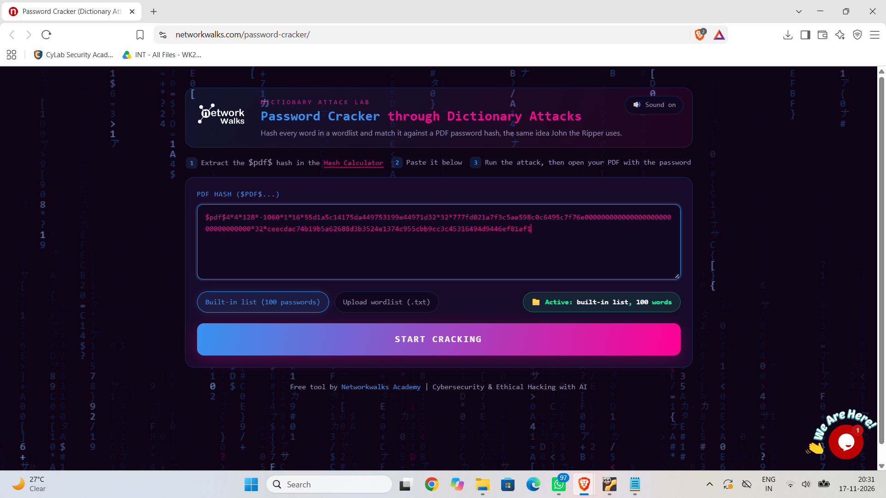
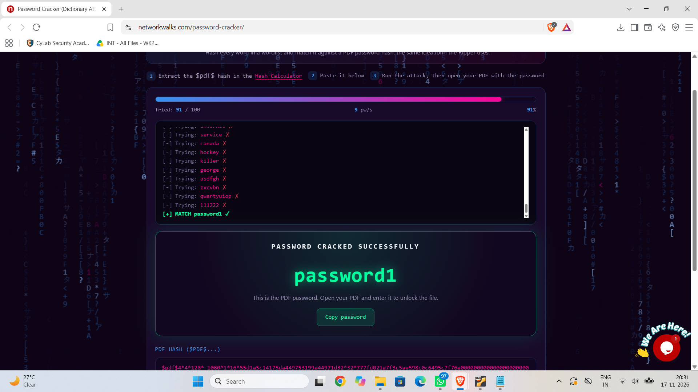
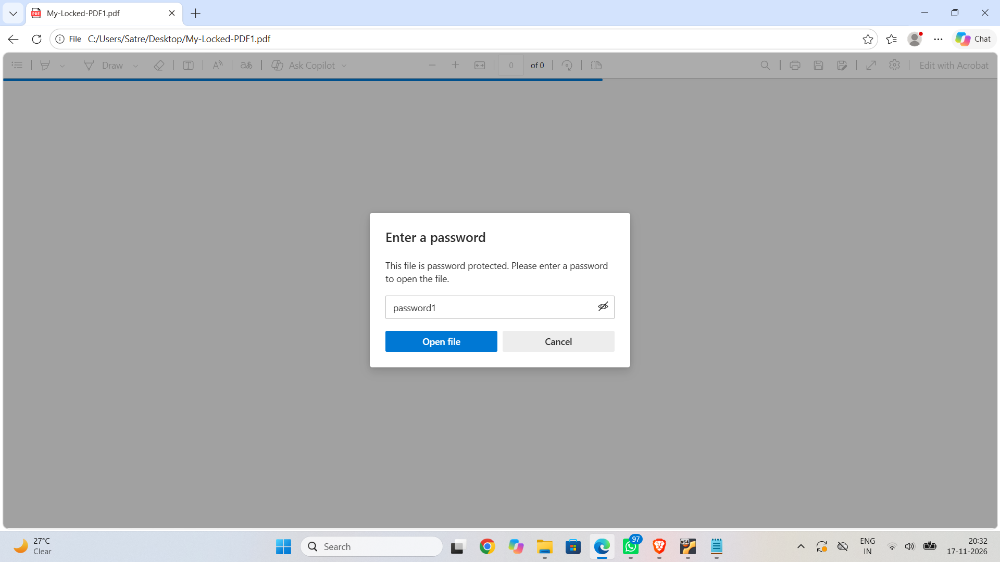

# NetworkWalks – Week 03: Password Security

**Program:** NetworkWalks Cybersecurity Program  
**Batch:** B084B  
**Author:** Prathamesh Kisan Satre

---

## About This Repository

This repository contains my Week 03 practical work as part of the NetworkWalks Cybersecurity Program.

This week's practical exercises focused on password security, password-protected PDF files, hash extraction, hash calculation, and hands-on practice using John the Ripper and NetworkWalks lab tools.

## Tools Used

- John the Ripper (JTR)
- NetworkWalks Lab Tools
- Hash Utilities

---

## Practical Work and Screenshots

### 1. Settings JTR

Screenshot documenting the John the Ripper settings used in the lab.


### 2. Hash Extract

Screenshot of the hash extraction practical.


### 3. Hash File

Screenshot showing the hash file used in the practical.


### 4. JTR Password Crack

Screenshot documenting the John the Ripper practical exercise.


### 5. Flag 1

Screenshot from the first flag-related lab exercise.


### 6. Flag 3

Screenshot from the third flag-related lab exercise.


### 7. Hash Calculation

Practical exercise related to hash calculation.


### 8. Hash

Screenshot of the hash-related practical exercise.



### 9. Password Crack

Screenshot from the password auditing practical.



### 10. Locked PDF

Practical exercise involving a password-protected PDF file.



### 11. Flag

Screenshot from the flag-related practical exercise.


---

## Learning Outcomes

Through these practical exercises, I gained exposure to:

- Understanding password security concepts.
- Working with password-protected PDF files.
- Understanding John the Ripper and its settings.
- Learning about hash extraction.
- Understanding hash files and hash calculation.
- Exploring password auditing in an authorized lab environment.
- Working with NetworkWalks cybersecurity lab tools.

## Repository Structure

```text
NetworkWalks-Week-03-Password-Security/
│
├── README.md
└── Screenshots/
    ├── Settings_JTR.png
    ├── Hash_Extract.png
    ├── Hash_File.png
    ├── JTR_Password_Crack.png
    ├── Flag_1.png
    ├── Flag_3.png
    ├── Hash_Calculation.png
    ├── Hash.png
    ├── Password_Crack.png
    ├── Locked_pdf.png
    └── Flag.png
```

## Disclaimer

All practical activities documented in this repository are intended for educational purposes and authorized cybersecurity lab environments.

## Acknowledgement

Thanks to NetworkWalks and Waqas Karim for the guidance and learning opportunities.

---

**Author:** Prathamesh Kisan Satre  
**Program:** NetworkWalks Cybersecurity Program  
**Batch:** B084B
